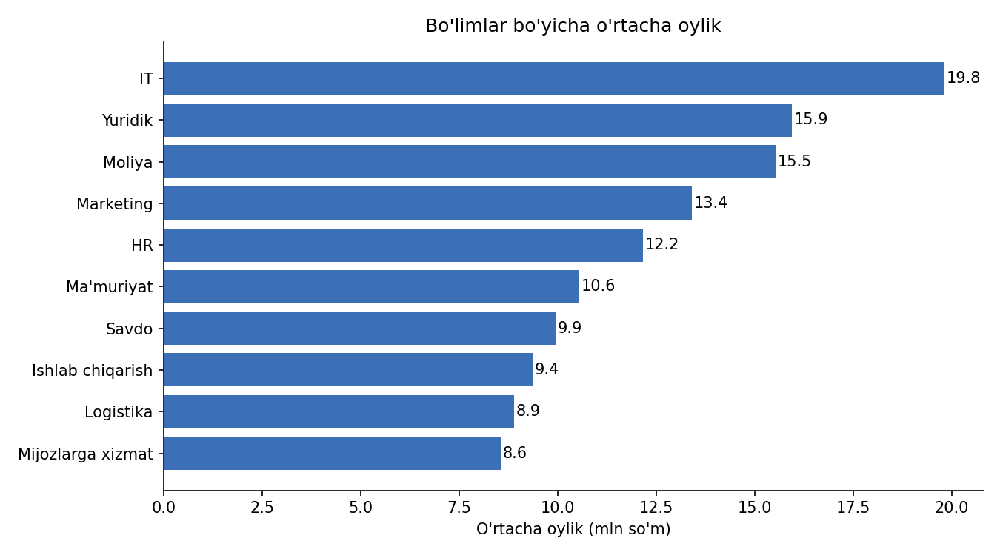
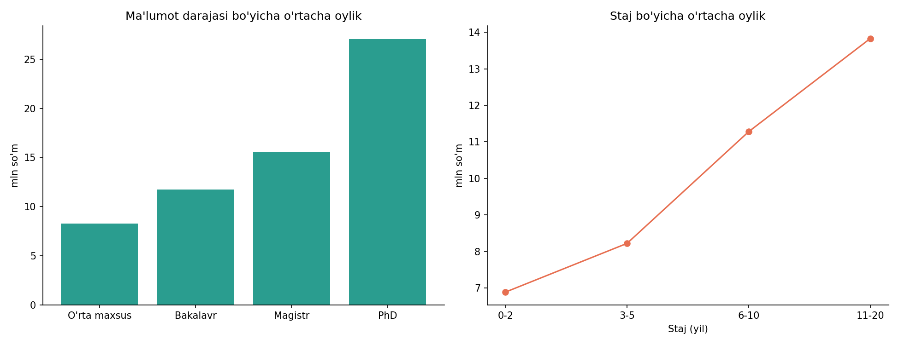
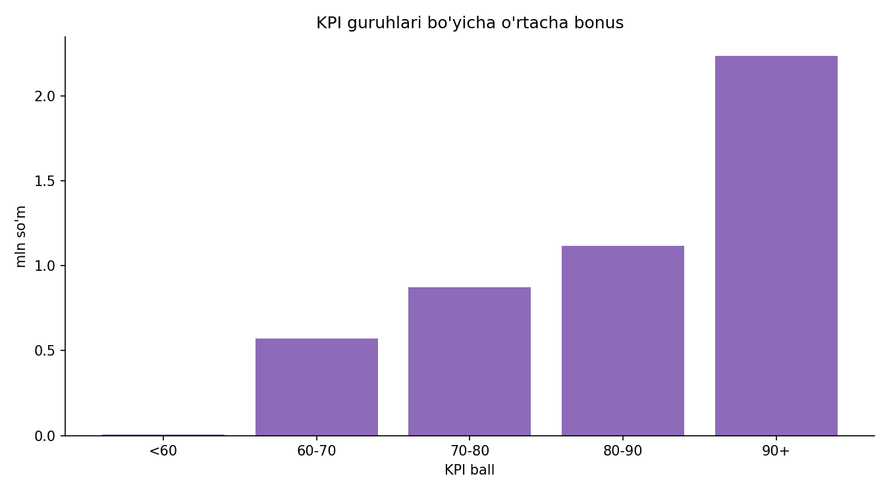
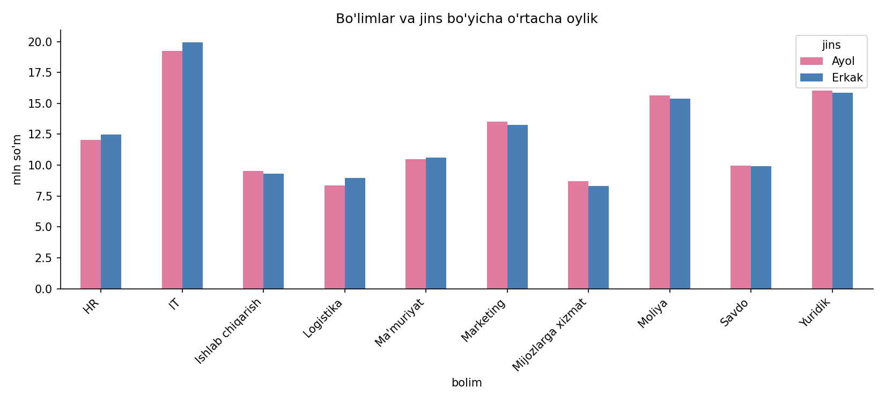

# Korxona xodimlari HR tahlili

22 000 xodimdan iborat korxona ma'lumotini Python va pandas yordamida tozalab, tahlil qildim. Maqsad: maosh, bonus va KPI kimga, nima uchun berilishini tushunish.

## Asosiy savollar
1. Qaysi bo'limlarda o'rtacha maosh eng yuqori?
2. Ma'lumot darajasi va staj maoshga qanchalik ta'sir qiladi?
3. KPI ball bonus bilan bog'liqmi?
4. Ayol va erkak xodimlar maoshida farq bormi?

## Ma'lumot haqida
- Hajmi: 22 000 xodim, 15 ta ustun
- Ustunlar: ID, FIO, jins, yosh, viloyat, filial, bo'lim, lavozim, ma'lumoti, ishga kirgan sana, staj, oylik, bonus, KPI ball, ish holati
- Manba: o'quv kursidagi API orqali yuklab olingan

## Qilingan ishlar
- Ma'lumotni `requests` orqali yuklab, `pandas` DataFrame'ga o'tkazish
- Bo'sh qiymatlar, takroriy yozuvlar va ish holati turlarini tekshirish
- Yangi ustunlar yaratish: jami daromad, yosh, staj va KPI guruhlari
- `groupby` va `pivot_table` yordamida bo'lim, jins, ma'lumot darajasi bo'yicha tahlil
- `matplotlib` bilan grafiklar
- Power BI uchun tozalangan CSV tayyorlash

## Asosiy topilmalar

**1. Bo'limlar.** Eng yuqori o'rtacha oylik IT bo'limida (19,8 mln so'm), undan keyin Yuridik (15,9) va Moliya (15,5). Eng past: Mijozlarga xizmat (8,6) va Logistika (8,9). IT va Mijozlarga xizmat o'rtasida farq taxminan 2,3 baravar. O'rtacha KPI ball bo'limlar bo'yicha deyarli bir xil (77,8 dan 78,5 gacha).

**2. Ma'lumot darajasi va staj.** Ma'lumot darajasi oshgani sari maosh keskin oshadi: PhD egalari o'rtacha 27,1 mln, magistrlar 15,6 mln so'm oladi. Staj ham maoshni oshiradi: 0-2 yillik xodimlar o'rtacha taxminan 6,9 mln, 11-20 yillik xodimlar taxminan 13,8 mln oladi. Staj va oylik o'rtasidagi korrelyatsiya 0,27 (o'rtacha-kuchsiz bog'liqlik).

**3. KPI va bonus.** KPI ball bonus bilan o'rtacha kuchli bog'liq (korrelyatsiya 0,54), lekin oylik maosh bilan deyarli bog'liq emas (-0,01). KPI bali 90 va undan yuqori bo'lgan 2 514 xodim (11,4%) jami 5,62 mlrd so'm bonus olgan. Ularning o'rtacha bonusi 80-90 ball guruhidagilardan taxminan 2 baravar ko'p.

**4. Jins bo'yicha maosh.** Ayollarning o'rtacha oyligi 11,57 mln, erkaklarniki 11,03 mln so'm (median: 9,52 va 8,78 mln). Bo'limlar ichida ayol va erkak maoshi deyarli bir xil, shuning uchun jins bo'yicha sezilarli maosh tengsizligi topilmadi. Umumiy farqning sababi (masalan, bo'limlar yoki lavozimlar tarkibi) alohida tekshirilmagan.

**Eslatma.** Korrelyatsiya sabab-oqibatni isbotlamaydi. Bu topilmalar faqat shu ma'lumot doirasidagi bog'liqliklarni ko'rsatadi.

## Vositalar
Python, pandas, NumPy, matplotlib, Jupyter Notebook, Power BI (jarayonda)

## Fayllar
- `HR_tahlil_portfolio_(1).ipynb`: asosiy tahlil (natijalar bilan)
- `grafik_*.png`: grafiklar
- `xodimlar_tozalangan.csv`: Power BI uchun tozalangan ma'lumot
- `POWER_BI_qollanma.md`: Power BI dashboard rejasi va DAX formulalari

## Muallif
Xusniddin Yergashov, Junior Data Analyst

Telegram: @Xusniddin_Tg | Email: xuergashev2005@gmail.com
